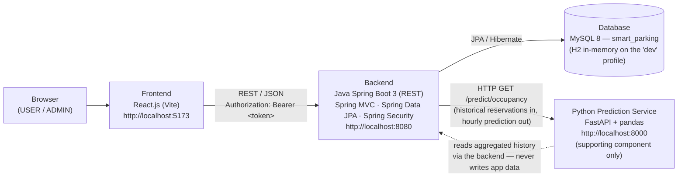
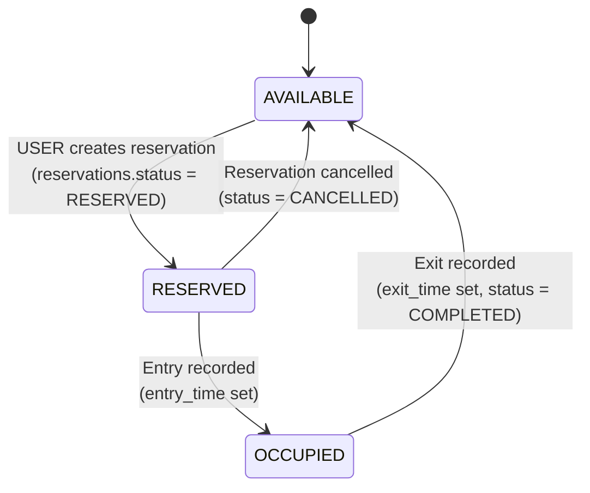

# Architecture — Smart Parking Management System

## 1. System Overview

Three-tier web application plus one supporting service. Java Spring Boot is the primary backend; Python is used only for prediction.



ASCII equivalent:

```
 Browser ──> React (Vite) :5173 ──REST/JSON──> Spring Boot :8080 ──JPA──> MySQL 8
                                                     │
                                                     └──HTTP──> Python FastAPI :8000
                                                                  (occupancy prediction only)
```

**Rules of the architecture**

- The frontend talks **only** to the Spring Boot backend. It never calls the Python service or the database directly.
- The backend is the single owner of all business logic and all writes to MySQL.
- The Python service is **read-only intelligence**: the backend sends it aggregated historical reservation data (or it computes from data the backend provides), and it returns predicted hourly occupancy. If the Python service is down, the backend returns a clear error for the prediction endpoint only — every other feature keeps working.
- Slot status is **never stored**. There is no status column on `parking_slots`; AVAILABLE / RESERVED / OCCUPIED is derived at read time from `reservations` (see §5).

## 2. Components

### Frontend — React.js (Vite) · Phase 3

| Component / page | Purpose |
|---|---|
| `LoginPage` / `RegisterPage` | Auth forms; stores the token and the current user (`full_name`, `email`, `role`) |
| `LocationsPage` | Lists `parking_locations`; links to a location's slot map |
| `SlotMapPage` | Live grid of slots for one location, coloured by derived status; auto-refreshes; opens the booking form for an AVAILABLE slot |
| `BookingForm` | Vehicle selector (own vehicles), `start_time` / `end_time` pickers; shows the estimated fee |
| `MyVehiclesPage` | CRUD for the user's own `vehicles` |
| `MyReservationsPage` | The user's reservations with status and Cancel / Entry / Exit actions |
| `AdminLocationsPage` | ADMIN: CRUD for locations and their slots |
| `AdminDashboardPage` | ADMIN: dashboard stats + all-reservations table with filters |
| `PredictionPanel` | Hourly predicted-occupancy chart + peak hour for a location/date (shown to USER and ADMIN) |
| API client module | Single place for the base URL and the `Authorization` header |

### Backend — Java Spring Boot 3 · Phase 2

Package plan (`com.codespark.smartparking`), layered controller → service → repository:

| Layer | Classes (planned) | Responsibility |
|---|---|---|
| Config / security | `SecurityConfig` | Spring Security, role rules (`/api/admin/**` = ADMIN, etc.), password encoder, token filter |
| Controllers | `AuthController`, `LocationController`, `SlotController`, `VehicleController`, `ReservationController`, `AdminController`, `PredictionController` — v3 adds `PricingController`, `WaitlistController`, `NotificationController`, `ReviewController` (payment/QR/reschedule live on `ReservationController`; promos/CSV/waitlist admin views on `AdminController`) | HTTP + validation only; no business logic; paths exactly as in `docs/API.md` |
| Services | `AuthService`, `LocationService`, `SlotService`, `VehicleService`, `ReservationService`, `DashboardService`, `PredictionService` — v3 adds `PricingService`, `PaymentService`, `WaitlistService`, `NotificationService`, `ReviewService`, `PromoService`, `QrService`, `ScheduledTasks` (see §6) | Business rules: ownership checks, overlap check, lifecycle transitions, fee calculation, derived slot status, dashboard aggregation, calling the Python service |
| Repositories | `UserRepository`, `ParkingLocationRepository`, `ParkingSlotRepository`, `VehicleRepository`, `ReservationRepository` — v3 adds `PromoCodeRepository`, `PaymentRepository`, `WaitlistEntryRepository`, `NotificationRepository`, `ReviewRepository` | Spring Data JPA; custom queries for overlap lookup, derived status, and dashboard aggregates |
| Entities | `User`, `ParkingLocation`, `ParkingSlot`, `Vehicle`, `Reservation` — v3 adds `PromoCode`, `Payment`, `WaitlistEntry`, `Notification`, `Review` | JPA entities mapping 1-to-1 to the tables in `database/schema.sql`; enums `Role`, `VehicleType`, `ReservationStatus` (+ v3: `PromoType`, `PaymentStatus`, `WaitlistStatus`, `NotificationType`) |
| DTOs | Request/response records per endpoint (see `docs/API.md`) | The API never exposes entities (and never `password_hash`) directly |

Profiles: default profile → MySQL 8 datasource. `dev` profile → H2 in-memory datasource with JPA `ddl-auto` so the app runs with no local MySQL install (development/demo only).

### Database — MySQL 8

Schema is defined in `database/schema.sql` and diagrammed in `database/ER_DIAGRAM.md`. Tables (10): `users`, `parking_locations`, `parking_slots`, `vehicles`, `reservations`, plus the v3 tables `promo_codes`, `payments`, `waitlist_entries`, `notifications`, `reviews`. That file is the source of truth for every table and field name used in the API and code.

### Python Prediction Service — FastAPI · later phase

| Item | Detail |
|---|---|
| Endpoint | `GET /predict/occupancy?locationId={id}&date={YYYY-MM-DD}` (internal; called by the backend, not the browser) |
| Input | Location id + date, plus historical reservation aggregates supplied by / fetched through the backend |
| Method (MVP) | Group historical `reservations` for the location by hour of `start_time`; average occupancy per hour = reservations active in that hour ÷ total slots; apply the same profile to the requested date, adjusted by day-of-week if enough history exists |
| Output | Hourly series `[{ "hour": 9, "predictedOccupancyPercent": 72.5 }, ...]`, `peakHour`, `peakOccupancyPercent` |
| Fallback | With little/no history, return a flat low-confidence profile rather than failing |

## 3. Request Flow — Booking a Slot

The core flow. Numbering matches the sequence diagram.

```mermaid
sequenceDiagram
    actor User
    participant FE as React Frontend
    participant BE as Spring Boot Backend
    participant DB as MySQL

    User->>FE: Pick location, slot, vehicle, start_time, end_time
    FE->>BE: POST /api/reservations  { vehicleId, slotId, startTime, endTime } + token
    BE->>BE: Authenticate token, role = USER
    BE->>DB: Load vehicle — check vehicles.user_id = current user
    BE->>DB: Load slot + its location (for hourly_rate)
    BE->>BE: Validate end_time > start_time
    BE->>DB: Overlap check on (slot_id, start_time, end_time) for status IN (RESERVED, OCCUPIED)
    alt Overlap found
        DB-->>BE: conflicting reservation
        BE-->>FE: 409 Conflict — slot already booked for that window
        FE-->>User: Show rejection message
    else No overlap
        BE->>BE: fee_amount = ceil(hours, min 1) × hourly_rate
        BE->>DB: INSERT INTO reservations (..., status = RESERVED, fee_amount)
        DB-->>BE: new reservation id
        BE-->>FE: 201 Created — reservation with status RESERVED
        FE-->>User: Reservation shown; slot now displays RESERVED
    end
```

**Other flows in brief**

- **Live slot map:** `GET /api/locations/{locationId}/slots` → backend loads the location's active slots and, for each, checks reservations: any `OCCUPIED` reservation → OCCUPIED; else any `RESERVED` reservation with `end_time >= now` → RESERVED; else AVAILABLE. The frontend re-fetches this on an interval while the page is open.
- **Entry:** `POST /api/reservations/{id}/entry` → ownership/admin check → status must be `RESERVED` → set status `OCCUPIED`, `entry_time = now`.
- **Exit:** `POST /api/reservations/{id}/exit` → status must be `OCCUPIED` → set status `COMPLETED`, `exit_time = now`, recompute final `fee_amount` from the booked window (MVP: fee stays based on the reserved window; overstay billing is out of scope).
- **Cancel:** `POST /api/reservations/{id}/cancel` → status must be `RESERVED` → set status `CANCELLED`. The slot immediately reads as AVAILABLE again because cancelled reservations are ignored by the derivation.
- **Prediction:** Browser → `GET /api/predictions/occupancy` on the backend → backend calls the Python service and returns its hourly prediction. If Python is unreachable, the backend falls back to the same hourly-occupancy calculation in Java over the reservations in its own database and still returns `200` — the endpoint never errors just because Python is down.

## 4. Slot Lifecycle — State Machine

A slot's displayed status is a projection of its reservations. The same states are the `reservations.status` values, which **are** stored.



| Slot shows | When (derived from `reservations` for that `slot_id`) |
|---|---|
| OCCUPIED | A reservation exists with `status = 'OCCUPIED'` |
| RESERVED | No OCCUPIED reservation, and a reservation exists with `status = 'RESERVED'` and `end_time >= NOW()` |
| AVAILABLE | Neither of the above — e.g. the slot has no reservations, or only COMPLETED / CANCELLED ones, or RESERVED ones that have already ended (`end_time < NOW()`). A slot with `is_active = 0` is hidden from the user map entirely. Note this is a *current-status* view: a slot booked for tomorrow still shows RESERVED today, and the booking-time overlap check (§3) is what protects specific time windows. |

Reservation status lifecycle (stored, `reservations.status`):

```
RESERVED ──entry──> OCCUPIED ──exit──> COMPLETED
   │
   └──cancel──> CANCELLED
```

No other transitions are permitted; the service layer rejects them (see API error table in `docs/API.md`).

## 5. Cross-Cutting Decisions

- **Authentication:** Spring Security with a token returned by `/api/auth/login` and sent as `Authorization: Bearer <token>`; passwords stored only as `users.password_hash` (BCrypt). Roles come from `users.role` (`USER` / `ADMIN`).
- **Validation & errors:** Bean Validation on request DTOs; one consistent error body `{ timestamp, status, error, message, path }` for 400 / 401 / 403 / 404 / 409 responses.
- **Double-booking safety:** The overlap check and the insert run in one service transaction. MySQL cannot express a time-range exclusion constraint, so correctness relies on this transactional check plus the `(slot_id, start_time, end_time)` index for lookup speed — acceptable and documented for hackathon scale.
- **Fees:** `fee_amount` is a snapshot stored on the reservation at creation (and finalised at exit), so later edits to a location's `hourly_rate` never rewrite history.
- **Time handling:** All timestamps are `DATETIME` in the server's local time (Asia/Kolkata for the demo); the API sends ISO-8601 strings.

---

## 6. v3 Expansion — Pricing, Payments, Waitlist, Notifications, Reviews, Scheduler

All v3 behaviour lives in the Spring Boot backend (the React/Python parts of the system are unchanged in shape). Design contract: `docs/API_V3_CONTRACT.md`; endpoint detail: `docs/API.md` §8–§14.

### Pricing (`PricingService`)

One code path prices both the public quote endpoint and reservation creation, so the number a user is quoted is the number they are charged: base (billable hours × rate) → surge multiplier from `PredictionService`'s predicted occupancy at the start hour (≥85% → ×1.50, ≥70% → ×1.25, else ×1.00 — the prediction keeps its Python→Java fallback) → promo discount on the surged amount. The breakdown (`base_amount`, `pricing_multiplier`, `discount_amount`) is snapshotted onto the reservation; `fee_amount` stays the single final amount every existing consumer reads. Promo validity is centralised here too: quotes fail soft (applied=false + reason), creates fail hard (400).

### Payments (`PaymentService`)

A `payments` row is created in the same transaction as the reservation (PENDING, amount = final fee). Paying is a simulated gateway transition to PAID with a generated transaction reference; a refund is not a separate flow — cancelling a PAID reservation flips its payment to REFUNDED inside `ReservationService.cancel`, so money state can never diverge from booking state.

### Waitlist (`WaitlistService`)

Entries are location+window based, FIFO per location. Promotion is event-driven from the one place a slot actually frees up — reservation cancellation — plus the scheduler for expired offers. The fit rule (vehicle type matches slot type, or slot is GENERAL) and the overlap re-check at claim time keep an offer from ever double-booking a slot. `WaitlistService` deliberately does not depend on the `ReservationService` bean (it builds reservations directly and reuses its static DTO mapper), avoiding a circular dependency with `ReservationService`, which calls promotion on cancel.

### Notifications (`NotificationService`)

A single `create(userId, type, title, message)` hook called from booking, payment, cancellation, waitlist promotion and the no-show sweep — notifications are a side effect of domain events, written in the same transaction, never a separate user action.

### Reviews (`ReviewService` + rating aggregation in `LocationService`)

Eligibility (own, COMPLETED, once) is enforced in the service; the UNIQUE constraint on `reviews.reservation_id` is the backstop. Location rating aggregates are computed on read from `reviews` (average rounded to 1dp + count) and exposed on the location DTO.

### Scheduler (`ScheduledTasks`, `@EnableScheduling`)

A 60-second sweep handles the two time-based rules: RESERVED reservations 30 minutes past start with no entry become NO_SHOW (+ notification), and OFFERED waitlist entries older than 15 minutes become EXPIRED and promote the next in queue. Everything else in the system is request-driven; this is the only background component.

### QR pass (`QrService`)

The booking-pass QR is rendered server-side with ZXing (`image/png`), encoding a compact pipe-delimited payload (reservation id, slot code, plate, window) that a gate scanner could verify against the API.
